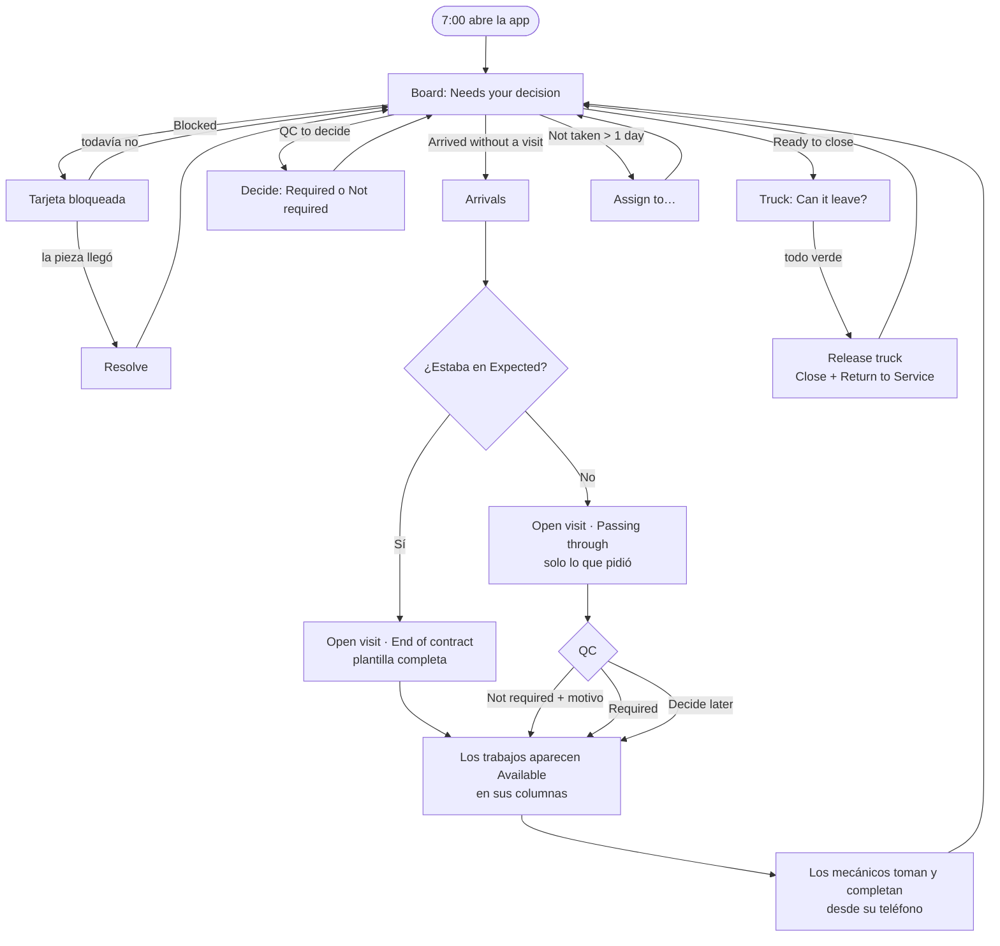

# Task flow: un día del Shop Manager con la pizarra

**Estado:** propuesta, parte de [`README.md`](README.md). Describe cómo **sería** el día con el
rediseño, no cómo funciona hoy. Usa las pantallas del [boceto](mockup.html): Board, Arrivals, Open
visit, Truck. Datos de ejemplo: los mismos camiones del boceto.
**Fecha del caso:** un martes cualquiera. Taller de 7:00 a.m. a 5:00 p.m.; 4 mecánicos (Anthony
general, Luis Alignment, Daniel PM, Mike Detailing) y 2 personas de Safety.

**Regla del caso:** el Manager **no registra** el trabajo de nadie. Cada cosa la registra quien la
hace. El Manager planea, prioriza, decide excepciones y libera.

---

## Resumen del día

| Hora | Qué pasa | Dónde | Qué hace el Manager | Toques |
|---|---|---|---|---|
| 7:00 | Empieza el día | Board | Mira "Needs your decision" | 0 |
| 7:05 | Hay un bloqueo de ayer (804, faltan piezas) | Board → tarjeta | Confirma que la pieza llega; deja el bloqueo | 1 |
| 7:10 | Planea la semana | Arrivals | Ve quién vuelve por fin de contrato | 1 |
| 7:15 | Prioriza | Board → tarjeta | ★ al 901, que sale el jueves | 2 |
| 8:10 | Llega el 705, de paso | Arrivals → Open visit | Abre la visita: Passing through + Fuel filter, QC no requerido | 5–6 |
| 9:30 | Llega el 927, fin de contrato, previsto | Arrivals → Open visit | Abre la visita con la plantilla completa | 3 |
| 10:00 | Inspección del 927 | Truck → Inspection | La hace él o un mecánico con permiso; los defectos caen en Repairs | (hoja de hoy) |
| 10:30 | Recorre la yard con el teléfono | Board en teléfono | Busca "918" y ve todo lo suyo | 2 |
| 11:00 | Decide el QC del 918 | Board → "QC to decide" | Required | 2 |
| 12:15 | Llega la pieza del 804 | Board → tarjeta bloqueada | Resolve | 2 |
| 1:30 | Safety devuelve el 901 (espejo flojo) | Board | Nada que hacer: el correctivo ya está Available en Repairs | 0 |
| 2:30 | Un trabajo lleva más de un día sin que nadie lo tome | Board | Lo asigna a alguien | 3 |
| 3:40 | El 705 queda listo | Board → "Ready to close" → Truck | Release truck | 3 |
| 4:45 | Cierre del día | Board | Revisa lo que queda y las llaves | 0–2 |
| 5:00 | El reloj de cada mecánico se cierra solo (D20) | — | Nada | 0 |

**En total, el Manager hace unos 25–30 toques de decisión en el día**, y ninguno es para
registrar el trabajo de otro. El detalle de cada paso está abajo.

---

## Diagrama

---

## Paso a paso

### 7:00 · Empezar el día: "¿qué necesita de mí?"

- **Pantalla:** Board (es el inicio; antes era el Dashboard).
- **Qué ve primero:** la franja **Needs your decision**:
  `1 Blocked · 0 Ready to close · 1 Arrived without a visit · 1 QC to decide`.
- **Debajo,** la pizarra completa. El 901 aparece en PM (Daniel, in progress), Repairs, Alignment,
  Detailing y QC; el 918 en Detailing (Mike) y Alignment ("With Mike").
- **Qué no tiene que hacer:** abrir camión por camión ni revisar quién empezó qué. Lo de ayer
  quedó registrado por los mecánicos, y el reloj de cada uno se cerró solo a las 5:00 p.m. (D20).

### 7:05 · El bloqueo de ayer (804)

- Toca el contador **1 Blocked**: la pizarra deja a la vista solo el 804 · Air leak · "Waiting for
  parts" (Anthony, ayer 3:40 p.m.).
- Toca la tarjeta: ve el motivo, la nota de Anthony y que viene de un **QC failed**.
- **Decisión:** la pieza llega al mediodía. No toca nada; el bloqueo se queda.
- *Hoy:* lo mismo, pero desde el Dashboard o el Truck.

### 7:10 · Planear la semana (Arrivals)

- **Pantalla:** Arrivals.
- **Expected · end of contract:** 927 (hoy), 955 (miércoles), 961 (jueves, "Early broke contract").
  Sale de Ninox (`driver_pay` + `returns`).
- **Arrived · needs a visit:** el 933, que Samsara vio entrar anoche y no estaba previsto.
- **Decisión:** el 933 lo deja para después de hablar con Dispatch. El 961 no estaba en la lista de
  hoy (la app lo descartaba); ahora sí sale.

### 7:15 · Prioridades

- En el Board, abre el menú de la tarjeta del 901 → **★ Priority**. Dispatch dice que sale el jueves.
- La ★ aparece en **todas** las tarjetas del 901 y sube en cada columna y en la lista de los
  mecánicos. Es el asterisco de la pizarra física.
- **2 toques.**

### 8:10 · Llega un camión de paso (705)

1. Samsara lo ve entrar. En Arrivals aparece **"Arrived · not on the return list → Passing
   through?"** (llega hasta 1–2 h tarde; el Manager no espera al aviso si lo ve llegar).
2. **Open visit** → el tipo ya viene **Passing through**. La plantilla no trae PM, Alignment ni
   Detailing; quedan **Not required · Passing through**, a su nombre, sin escribir nada.
3. Agrega **Fuel filter replacement** en Repairs.
4. **Quality Check → Not required** → motivo: "Filter only".
5. **Open visit.**

- **Resultado:** aparece **una** tarjeta, 705 · Fuel filter · **Available**, en Repairs. Anthony
  la ve en su teléfono en "Available for me".
- **5–6 toques y una línea escrita.** *Hoy:* crear la WO, que nace con PM, Alignment, Detailing y
  QC; cancelar tres Jobs con motivo, uno por uno; y el QC no se puede cancelar (D55 R9), así que el
  705 tendría que esperar a Safety.

### 9:30 · Llega un fin de contrato previsto (927)

1. Arrivals: el 927 pasa de Expected a **Arrived**.
2. **Open visit** → el tipo ya viene **End of contract**: inspección, PM, Alignment, Detailing y QC
   **Required**. No cambia nada.
3. **Open visit.** **3 toques.**

- **Resultado:** 927 aparece en Inspection, PM, Alignment y Detailing como **Available**, y en QC
  como "Required · waits for the work".

### 10:00 · La inspección del 927

- La hace el Manager desde el Truck, o un mecánico con "Can inspect trucks" desde su teléfono. Es
  la hoja de hoy (D41), sin cambios.
- **Cada defecto cae solo** en su columna como Available: Brake chamber en Repairs; Tires LF y RF en
  Alignment (D54).
- **El Manager no asigna nada.** Si quiere a alguien en particular, usa "Assign to…" en la tarjeta.

### 10:30 · Recorrido por la yard (teléfono)

- Board en el teléfono: las columnas se apilan, con saltos rápidos arriba (`Inspection 1 · PM 2 ·
  Repairs 3…`).
- Escribe **918** en "Find truck": se resaltan sus tarjetas en Detailing (Mike, in progress) y
  Alignment ("With Mike": nadie más lo toma mientras Mike lo tiene, D57).
- **Llaves:** en el Truck 918 ve "With Mike". No tiene que preguntar.

### 11:00 · Decidir el QC del 918

- Contador **QC to decide** → 918 (visita "Other", abierta por una falla de Samsara).
- Toca la tarjeta en la columna QC → **Required**. Safety lo recibe cuando lo demás esté hecho.
- **2 toques.** Mientras está en "To decide", el 918 **no se puede liberar**.

### 12:15 · Llegó la pieza del 804

- Contador **Blocked** → tarjeta 804 → **Resolve** (nota opcional "Part arrived").
- La tarjeta vuelve a **Taken · Anthony**. Anthony ve en su teléfono que ya puede seguir.
- **2 toques.**

### 1:30 · Safety devuelve el 901

- Safety lo devuelve desde `/qc` con una nota: "Mirror loose". Eso crea un trabajo correctivo.
- En el Board aparece **901 · Mirror · driver side · Available** en Repairs ("QC failed"), y la
  tarjeta de QC del 901 dice **Failed · corrective work open**.
- **El Manager no tiene que hacer nada:** el trabajo ya está disponible para los generales. Cuando
  se complete, el 901 vuelve a la lista de Safety (ya es así hoy).

### 2:30 · Algo que nadie toma

- Contador **Not taken > 1 day** (propuesto; el boceto todavía muestra "QC to decide" en su lugar)
  → 944 · PM B Service, Available desde ayer.
- Menú de la tarjeta → **Assign to… → Daniel.** **3 toques.**
- Es la única asignación del día, y es una excepción.

### 3:40 · El 705 está listo

1. Anthony completó el filtro desde su teléfono y dijo **"Back at the office"** sobre las llaves.
2. El contador **Ready to close** pasa a 1 → toca → **Truck 705 · Can it leave?**:
   - Fuel filter · **Done**
   - PM · Alignment · Detailing · **Not required · Passing through · Cristian**
   - Quality Check · **Not required · Filter only · Cristian**
   - Keys · **Office**
3. **Release truck** → confirma. **3 toques.** Si hace Close + Return to Service juntos, o solo Close y Return to Service queda para cuando sale, está sin decidir (P56).

- El 705 sale de la pizarra.
- *Hoy:* Close Work Order en una pantalla y Return to Service en otra.

### 4:45 · Cierre del día

- Mira la pizarra. Lo terminado hoy está tachado al pie de cada columna.
- **Llaves:** abre los camiones con trabajo empezado. Si alguno dice "Unknown", se lo pregunta al
  último que lo tuvo.
- No cierra relojes: a las 5:00 p.m. se cierran solos (D20) y mañana cada mecánico toca Continue.

---

## Lo que el Manager **ya no hace**

| Antes | Ahora |
|---|---|
| Recorrer la pizarra física y pasarla a Ninox | Los mecánicos registran al tomar y completar |
| Asignar cada Job | Todo nace Available; asigna solo la excepción |
| Cancelar PM, Alignment y Detailing a mano en un camión de paso | La plantilla los deja Not required |
| Esperar a Safety en un camión que no necesita QC | QC Not required, con motivo |
| Abrir camión por camión para ver qué falta | La pizarra lo muestra todo; los contadores filtran |
| Preguntar quién tiene las llaves | El camión dice lo último que alguien registró |
| Cerrar la WO y hacer Return to Service por separado | Release truck |

## Excepciones que el flujo cubre

| Situación | Qué ve | Qué hace |
|---|---|---|
| Dos mecánicos tocan Take a la vez | El segundo ve "Someone just took it" | Nada |
| Un mecánico deja un trabajo a medias y se va | Sigue "In progress" a su nombre; mañana Continue | Nada; si no vuelve, Assign to… |
| Un esperado no llega | Arrivals: Expected | **Didn't come** |
| Samsara no ve la llegada (GPS tarde) | Nada en Arrived | Open visit desde Trucks, sin esperar |
| QC "To decide" al final del día | El camión no se libera | Decide Required o Not required |
| Llaves "Unknown" | Badge en el Truck | Pregunta; el mecánico lo corrige desde su app |

## Preguntas que este flujo deja para el Shop Manager

1. ¿Planea a las 7:00 o la noche anterior? Si es la noche anterior, Arrivals debería mostrar "mañana" primero.
2. ¿Quién decide el QC: él siempre, o Safety puede marcar "Not required"? (P46)
3. ¿"Not taken > 1 day" es el umbral correcto, o es medio día?
4. ¿Revisa las llaves al final del día, o solo cuando alguien no las encuentra?
