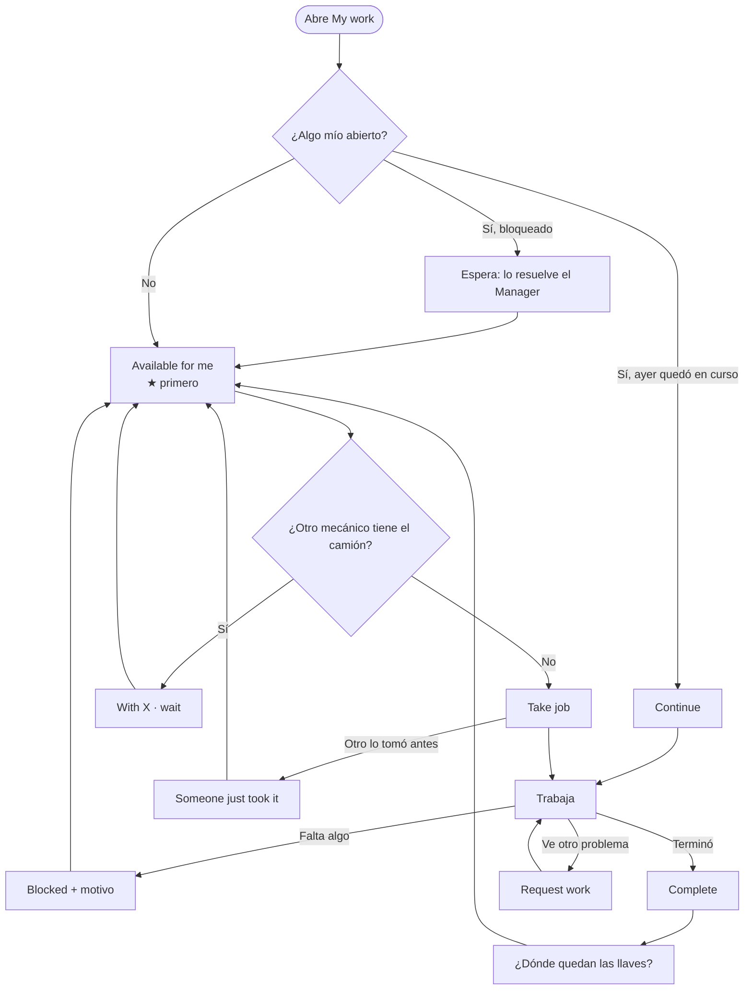

# Task flow: un día de los mecánicos con la pizarra

**Estado:** propuesta, parte de [`README.md`](README.md). Describe cómo **sería**, no cómo funciona
hoy. Pantalla: "My work" del [boceto](mockup.html).

**Tres casos distintos:**
- **Anthony**, mecánico general, en su teléfono.
- **Detailing**, en una tablet compartida por dos detailers (José y Mike).
- **Daniel**, mecánico de PM. **Su pantalla no cambia** (dueño, 2026-10-26).

**Cómo leer este documento:**
- ✅ = así funciona hoy en el código; se mantiene.
- ⚠️ = depende de una decisión abierta (la P entre paréntesis). Se escribe con la recomendación,
  pero **no es un hecho**.
- **Regla del caso:** el mecánico registra lo suyo con un toque (tomar, completar, bloquear). No llena
  formularios largos (prompt §7).

---

## 1. Anthony, mecánico general (teléfono)

### Resumen

| Hora | Qué pasa | Pantalla | Qué hace | Toques |
|---|---|---|---|---|
| 7:00 | Llega y abre la app | My work | Ve arriba "Yesterday still open · tap Continue" en el 804 | 0 |
| 7:02 | El 804 sigue bloqueado (faltan piezas) | My work | Nada: el bloqueo lo resuelve el Manager (D17) ✅ | 0 |
| 7:05 | Busca qué hacer | Available for me | Ve lo libre de Repairs: ★ primero (901 · Brake chamber), luego 705 · Fuel filter | 0 |
| 7:06 | Quiere el 901, pero lo tiene Daniel | Available for me | Ve "With Daniel · wait", sin poder tomarlo (D57 §3) ✅ | 0 |
| 7:07 | Toma el 705 | Tarjeta | **Take job** ⚠️ (P47: ¿empieza el tiempo aquí?) | 1–2 |
| 7:10 | Va por las llaves | — | La app dice dónde las dejaron: "Office" ⚠️ (llaves, RP-7) | 0 |
| 8:30 | Termina el filtro | My work | **Complete** → "¿Dónde quedan las llaves?" → **Back at the office** | 2 |
| 8:31 | El 705 sale de su lista | — | El Manager lo ve listo para cerrar en la pizarra | 0 |
| 8:35 | Toma el 901 (Daniel terminó el PM) | Available for me | Take job | 1–2 |
| 10:15 | Le falta una pieza | Tarjeta | **Blocked** → **Waiting for parts** | 2 |
| 10:16 | Su reloj se detiene si no tiene otro Job en ese camión (D18) ✅ | — | Vuelve a Available for me | 0 |
| 10:20 | Ve un espejo roto en el 918 | Camión 918 → Request work | Escribe "Driver mirror is cracked" (D8) ✅ | 3 |
| 12:15 | El Manager resolvió el 804 | My work | Ve "Resolved · tap Continue" → **Continue** ✅ | 1 |
| 1:40 | Safety devolvió el 901 (espejo flojo) | Available for me | Aparece "901 · Mirror · QC failed" ⚠️ (P54) → Take job | 1–2 |
| 4:30 | Termina el 804 | My work | Complete → **Left in the truck** | 2 |
| 5:00 | Cierre del día | — | El reloj se cierra solo a las 5:00 p.m. (D20) ✅ | 0 |

**Unos 15–20 toques en el día.** Ningún formulario, salvo el Request work, que es texto libre.

### Diagrama

### Detalle

- **Qué ve al abrir:**
  - **My work** arriba: lo suyo, con In progress primero y Blocked en ámbar con el motivo.
  - **Available for me** abajo: lo libre de su especialidad.
  - Hoy esas mismas cosas están repartidas en hasta 8 secciones posibles (To inspect, Team queue,
    Available in the shop, In Progress, Ready to start, Blocked, Waiting on manager, Paused). Cada una
    sale solo si tiene algo.
- **Su especialidad** son sus equipos en Setup → Shop workflow ✅ (D28). Un general ve Repairs (la cola
  del taller, D57 §5) ✅. Si también es de Alignment, ve las dos.
- **Take job:** gana el primero si dos tocan a la vez ✅ (`team-queue.service.ts:104`).
  - **Si P47 = sí,** Take también empieza el tiempo: un toque.
  - **Si P47 = no,** son Take y después Start: dos toques. El tiempo corre desde Start, cuando ya
    tiene las llaves. Hoy es así ✅.
- **Blocked:** propuesta de 4 opciones grandes (Parts · Approval · Truck · Other). ⚠️ Hoy son 7
  motivos (`MECHANIC_BLOCKER_REASONS`) ✅. "Waiting for the truck" no existe a propósito (D17: eso es
  pausa oficial del Manager). Agregarlo es una decisión y una migración.
- **Complete:** pregunta por las llaves ⚠️ (RP-7, necesita migración). Completar **no** devuelve las
  llaves solo (prompt §8).
- **Request work, notas, Completed, Trucks:** igual que hoy ✅ (D8, D-MG1).
- **Inspección:** si tiene "Can inspect trucks", ve "To inspect" arriba de My work ✅ (D41).
- **Ayudante (D23):** si el Manager lo agrega como ayudante, el trabajo sale en My work con "· helper" ✅.

---

## 2. Detailing (tablet compartida)

> ⚠️ **Todo este caso depende de P50, P51 y P52.** El diseño de cómo la tablet sabe quién trabaja es
> el frente C (README §10). Aquí va con la recomendación (tocar el nombre, sin contraseña) para
> poder discutirlo, no porque esté decidido.

### Resumen

| Hora | Qué pasa | Pantalla (tablet) | Qué hace | Toques |
|---|---|---|---|---|
| 7:00 | La tablet ya está abierta en Detailing | Detailing | Ve dos listas: **In progress** y **Available** (★ primero) | 0 |
| 7:05 | José empieza el 918 | Tarjeta 918 | **Start** → "Who is working?" → **José** ⚠️ (P50) | 2 |
| 7:05 | El 918 queda "With Detailing" para los demás mecánicos (D57 §3) | — | Nada | 0 |
| 9:30 | José se va a almorzar; Mike sigue el mismo camión | Tarjeta 918 | **Join** → **Mike** ⚠️ (P52: dos en el mismo trabajo, sin "ayudante") | 2 |
| 11:00 | Mike termina | Tarjeta 918 | **Complete** → "¿Dónde quedan las llaves?" → **Office** ⚠️ (P52: completa lo que empezó José) | 2 |
| 11:05 | José empieza el 901 | Tarjeta 901 | Start → José | 2 |
| 11:05 | ¿Y si Mike empieza otro camión a la vez? | — | ⚠️ P51: con una sola cuenta compartida, el reloj del primero se cerraría (D21). Por eso la recomendación es tocar el nombre | — |
| 5:00 | Cierre | — | Los relojes se cierran solos (D20) ✅ | 0 |

### Lo que cambia frente a hoy

| Hoy (código) | Propuesta | Decisión |
|---|---|---|
| Cada Job tiene un dueño; solo él lo completa (`work-orders.service.ts:1303`) | En Detailing el trabajo es **del equipo**: cualquiera empieza, bloquea o completa | P52 |
| Un reloj por persona (D21) | Igual, pero la persona se elige en la tablet | P50, P51 |
| Para que dos trabajen el mismo camión hace falta "Add helper" (D23) | Join, sin ayudante | P52 |
| Cada mecánico en su teléfono | Una tablet; la sesión no debe expirar a mitad del día | P50 |

**Riesgo (supuesto):** con "tocar el nombre" sin contraseña, alguien puede marcar horas a nombre de
otro, y esas horas se cobran a Finanzas (D34). Hay que diseñarlo (frente C) y que Carlos lo apruebe
(hoja de preguntas, Carlos 5).

---

## 3. Daniel, mecánico de PM (sin cambios)

| Hora | Qué hace | Pantalla | Estado |
|---|---|---|---|
| 7:00 | Ve **Waiting for PM**, ordenado por prioridad y espera (D-PM4) | PM home | ✅ igual |
| 7:05 | **Start PM** en el primero (D-PM3): toma y empieza en un toque | PM home | ✅ igual |
| 7:10 | Millaje (D10), partes con la más usada ya elegida (D-PM1), notas | PM service | ✅ igual |
| 9:40 | **Finish** | PM service | ✅ igual. No pregunta por las llaves, para que su pantalla no cambie |
| — | Un solo PM en curso a la vez (D2) | — | ✅ igual |

**Lo único que cambia alrededor de Daniel:**
- **En la pizarra del Manager,** sus PM salen en la columna PM con su estado. No hace nada distinto.
- **Si crea un PM en un camión sin Work Order abierta** ⚠️ (P53): hoy nace la WO con PM, Alignment,
  Detailing y QC. La propuesta es que nazca solo con el PM y el QC por decidir.
- **Si el tipo de visita no pide PM**, el camión no le aparece en Waiting for PM. Eso depende de qué
  trae cada plantilla (hoja de preguntas, Shop Manager 7 y 8).

---

## 4. Lo que el mecánico deja de hacer (si se aprueba)

| Hoy ✅ | Propuesta |
|---|---|
| Buscar en hasta 8 secciones qué es suyo y qué está libre | Dos listas: My work y Available for me |
| Esperar a que el Manager asigne lo que no entró a una cola (P44) | Todo lo sin dueño de su especialidad está disponible ⚠️ |
| Tachar en la pizarra física y que el Manager lo pase a Ninox | Complete en el teléfono; la pizarra se actualiza sola |
| Preguntar quién tiene las llaves | El camión dice lo último que alguien registró ⚠️ (RP-7) |

## 5. Excepciones

| Situación | Qué ve | Qué hace |
|---|---|---|
| Dos tocan Take a la vez | "Someone just took it" ✅ | Elige otro |
| El camión lo tiene otro | "With Luis · wait" ✅ | Elige otro |
| Se fue sin terminar | Al día siguiente: "Yesterday still open · tap Continue" ✅ (D20) | Continue |
| Tomó algo por error | **Let go**: vuelve a Available ✅ (no con su reloj corriendo en ese camión) | Let go |
| El Manager pausó el camión (pausa oficial) | La tarjeta dice "Paused" ✅ (D12) | Espera |
| Lo mandaron a taller externo | Sale de su lista ✅ (D24) | Nada |
| Sin conexión | "Offline · your changes are not sent" ✅ (`components/offline-strip.tsx`) | Espera la red; nada se pierde |

## 6. Preguntas que salen de este flujo

Ya están en la [hoja de preguntas](preguntas-validacion.md):
- P47: ¿tomar empieza el tiempo? Shop Manager 13, mecánico general 2, Carlos 5.
- P50–P52: la tablet de Detailing. Cerradas por el dueño el 26-oct (sin nombres, varios a la vez, cualquiera termina).
- P44: ¿todo lo sin dueño va a la cola? Shop Manager 12.
- Los motivos de bloqueo: mecánicos 3.
- Las llaves: mecánico general 4, detailer 5, Shop Manager 32.
